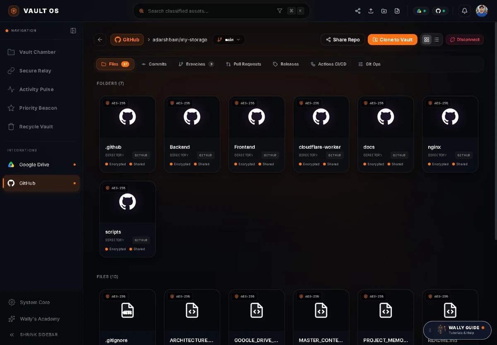
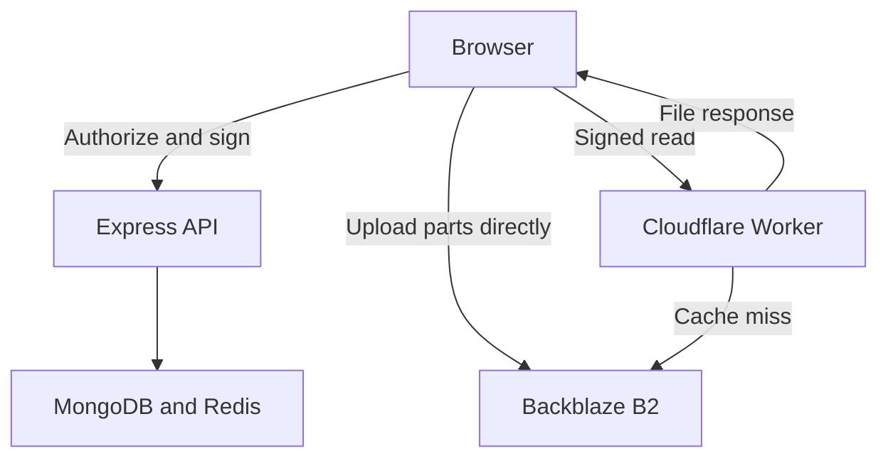

# Vault Storage

A file-storage application with GitHub and Google Drive workspaces, signed media delivery, and owner-managed plans.

[Open Vault](https://yourvaultstorage.com/) · [Architecture](docs/ARCHITECTURE.md) · [API map](docs/API.md) · [Security boundaries](docs/SECURITY.md)



*GitHub workspace, captured 25 October 2026. Product labels in the screenshot are not a security certification.*

## What I built

I developed the full Vault implementation while working with Anurag Singh on ProCodrr's Node.js storage-course material; the teaching version is simplified. My implementation includes the GitHub and Drive workspaces, transfers, owner controls, runtime plan rules, billing, and storage/media workflows. Vault is deployed and used by external users.

## Main workflows

- **Store files:** browser-managed multipart uploads to Backblaze B2, folder navigation, previews, downloads, and trash.
- **Work with GitHub:** browse and edit repository files; clone into a Vault workspace, stage changes, and build a multi-file Git commit.
- **Connect Drive:** browse folders and transfer between Vault and Google Drive; export Vault files to GitHub.
- **Share media:** public file/folder access, embeddable playback, allowed-origin settings, and player customization.
- **Manage access:** accounts, owner controls, subscriptions, and per-request feature/plan checks.

React · Node.js/Express · MongoDB · Redis · Backblaze B2 · Cloudflare Workers.

## How a file travels



The API handles permissions, metadata, upload signing, and completion. The Worker validates reads before cache/origin access. [Detailed flows and tradeoffs](docs/ARCHITECTURE.md).

## Run locally

Use Node.js 24, MongoDB, Redis, and a configured B2/S3-compatible bucket. Copy and configure [Backend/.env.example](Backend/.env.example) and [Frontend/.env.example](Frontend/.env.example) as their respective `.env` files before starting. OAuth, payments, and media delivery need their own provider configuration.

Run in separate terminals:

```sh
cd Backend
npm install
npm run dev
```

```sh
cd Frontend
npm install
npm run dev
```

[Backend setup](Backend/README.md) · [Frontend setup](Frontend/README.md) · [Worker setup](cloudflare-worker/README.md).

## Read the implementation

| Question | Start here |
| --- | --- |
| Upload, cache, Git, and entitlement decisions | [Architecture](docs/ARCHITECTURE.md) |
| Feature scope and evidence | [Features](docs/FEATURES.md) |
| Real route prefixes and examples | [API map](docs/API.md) |
| Metadata and storage relationships | [Data model](docs/DATA-MODEL.md) |
| Authentication, sharing, and known boundaries | [Security notes](docs/SECURITY.md) |

## Verification and limits

The repository contains [focused backend checks](Backend/README.md#checks). Dated portfolio checks exercised small uploads/downloads and selected provider-copy/commit operations. They do not establish every move/delete, interrupted transfer, checkout, or paid-tier lifecycle. Exact adoption counts, latency, operating cost, and production capacity are not asserted here.

GitHub has two distinct write paths: ordinary Contents API file edits and the Git workspace's blob/tree/commit/ref sequence. Neither is a transaction spanning GitHub, MongoDB, and B2. The architecture guide explains the boundary.
