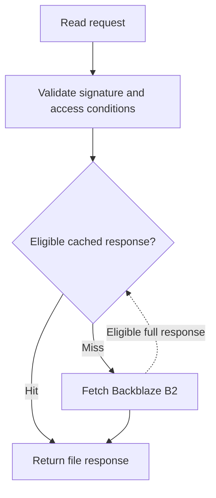

# Vault delivery Worker

Cloudflare Worker for signed file, thumbnail, and public-media reads from Backblaze B2.

[Application architecture](../docs/ARCHITECTURE.md) · [Security boundaries](../docs/SECURITY.md) · [Implementation](src/worker.js)



## Read modes

- **Ordinary file/thumbnail URLs:** HMAC-SHA256 covers path, content version, and expiry; signature/expiry validation precedes cache lookup.
- **Public media:** a signed encoded payload identifies the file and allowed origins. The Worker checks the payload and configured domain policy before serving it. This is not DRM or protection against a client copying downloaded bytes.

Canonical versioned cache keys avoid treating every expiring signed query as a separate object. The implementation handles Range requests; only eligible full responses are cached. Browser cache lifetime, Worker cache state, and authorization-token lifetime are separate.

## Configure and run locally

Use the repository's [package scripts](package.json) and [Wrangler configuration](wrangler.toml). Create an ignored `.dev.vars` for local bindings using the names below; a checked-in example file is not present.

```sh
npm install
npm run dev
```

The Worker needs `CDN_SIGNING_SECRET`, `B2_APPLICATION_KEY_ID`, and `B2_APPLICATION_KEY`, plus the non-secret configuration referenced by the implementation. The backend signing configuration must match the Worker. Never copy credential values into documentation or client bundles.

`npm run deploy` updates the configured Cloudflare Worker; it is an operational action, not a local verification step. `npm run tail` reads its logs. No deployment is performed by reading this guide.

## Limits

Cache hits can avoid repeated origin fetches. This does not establish a latency target, a globally replicated cache, instant revocation of client-cached content, or a zero-cost application. The repository source is not independent proof of the exact deployed revision.
