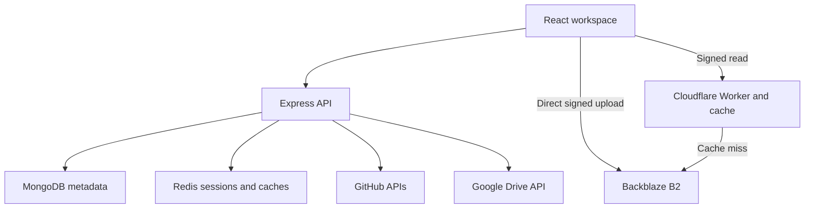
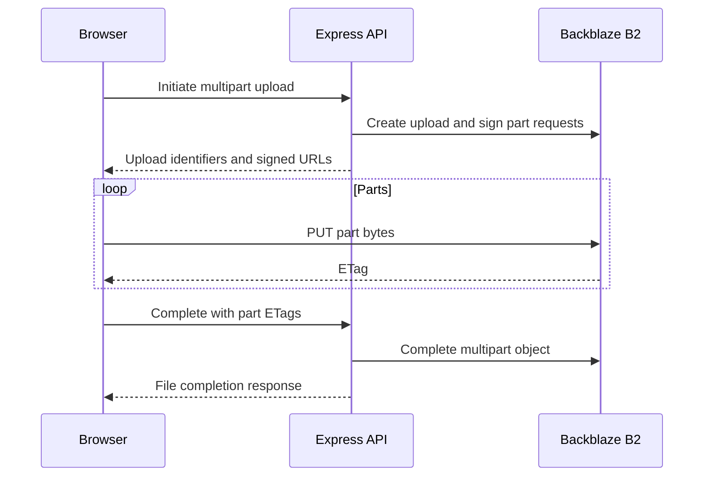
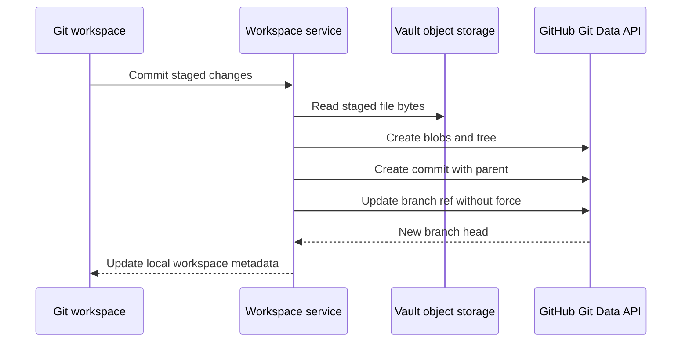

# Vault architecture

[Overview](../README.md) · [API map](API.md) · [Data model](DATA-MODEL.md) · [Security](SECURITY.md)

This is an implementation map, not a claim that every deployed path has been independently load- or security-tested.

## Components

| Responsibility | Implementation |
| --- | --- |
| Upload coordination and progress | [useUploadManager.js](../Frontend/src/hooks/useUploadManager.js) |
| Signing, completion, and file metadata | [file.service.js](../Backend/services/file.service.js), [s3.client.js](../Backend/integrations/storage/s3.client.js) |
| Signed delivery | [cloudflare.service.js](../Backend/integrations/cdn/cloudflare.service.js), [Worker](../cloudflare-worker/src/worker.js) |
| Repository browsing and individual file operations | [github.service.js](../Backend/services/github.service.js) |
| Vault-backed Git staging and commits | [gitWorkspace.service.js](../Backend/services/gitWorkspace.service.js) |
| Drive browsing and transfers | [drive.service.js](../Backend/services/drive.service.js) |
| Plans and feature access | [loadPlanContext.js](../Backend/middlewares/loadPlanContext.js), [requireFeature.js](../Backend/middlewares/requireFeature.js) |
| Public sharing and embeds | [share.service.js](../Backend/services/share.service.js) |

## Upload: control calls and file bytes

Upload bytes bypass the API's main request-body path; authorization, signing, completion, and metadata still require API work. The client coordinates retries and part state. An interrupted upload or metadata error needs recovery; MongoDB transactions cannot atomically commit an external B2 operation.

## Delivery: validate before cache access

For ordinary signed reads, the API signs the path, content version, and expiry. The Worker verifies the signature and expiry before checking its canonical, versioned cache key. Cache misses fetch B2; eligible full responses populate the cache. Range handling does not mean every partial response is stored independently.

Public media uses a separate signed-payload path and configured origin restrictions. See [Worker notes](../cloudflare-worker/README.md) for both modes. Browser cache freshness, Worker caching, and token lifetime are distinct; a link expiring does not erase bytes already downloaded or cached by a client. Cache hits may avoid an origin fetch, but no latency or whole-application cost guarantee follows.

## GitHub: two write mechanisms

**Repository file operations** in `github.service.js` use the Contents API for individual file creation, updates, and deletion. Each write is its own request/commit.

**Vault Git workspaces** in `gitWorkspace.service.js` stage Vault files and assemble Git objects:

The ref update publishes one commit containing the staged tree. This does not make all preceding API calls or subsequent local metadata writes atomic together. A changed branch can reject the non-forced ref update. Uploaded Git objects can remain unreferenced after a failure. Repository content is represented in Vault/B2; this is not a host-side `git clone` checkout.

## Integrations and plans

Drive transfer handlers support Vault ↔ Drive; GitHub transfer handlers support Vault → GitHub. A direct Drive ↔ GitHub operation is not established by those paths. Copy, move/source removal, and byte-integrity validation are separate behaviors.

Plan context is resolved for protected routes, with feature/rule middleware enforcing the relevant capability. Owner plan updates invalidate cached configuration. Billing code and visible plan controls do not by themselves establish successful checkout or ordinary paid-tier expiry behavior.

## Deployment and operational boundaries

The repository contains frontend S3/CloudFront deployment workflow, backend scripts, PM2/Nginx configuration, and Docker Compose. These are source configuration, not proof that every option runs in the current deployment. Review those files and your target environment before operating them; this guide does not execute a deployment.

There is no claimed global distributed job scheduler, container isolation for Git operations, zero-knowledge encryption guarantee, or universal zero-egress bill. Runtime configuration, provider permissions, signed-link handling, and recovery paths remain operational responsibilities.
